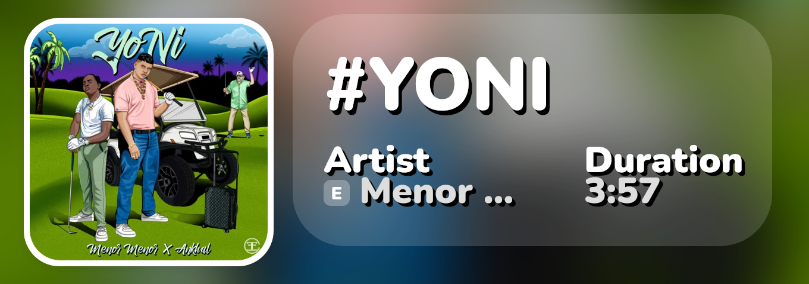
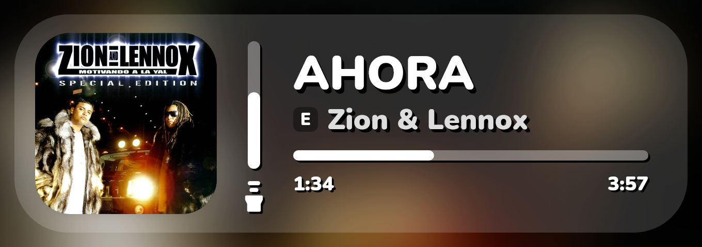
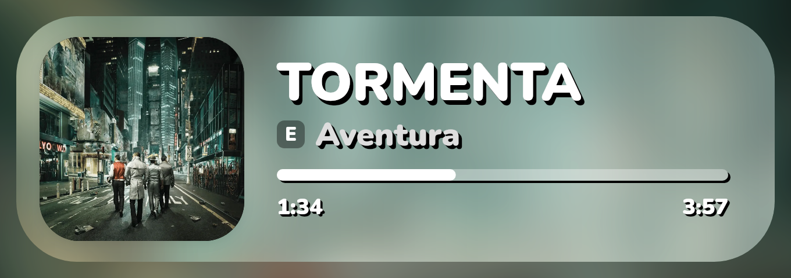

# music-cards

Tarjetas **"now playing"** para bots de música de Discord. Tres estilos con fondo borroso a partir de la portada y texto con sombra dura, generadas con [`@napi-rs/canvas`](https://github.com/Brooooooklyn/canvas) (no necesita dependencias nativas del sistema).

- Tamaño **680 × 240 px** en los tres estilos (exporta a **1360 × 480** con `scale: 2`, el valor por defecto).
- Fuente **Nunito Black** incluida.
- Acepta URL, ruta local o `Buffer` como portada; si falla, genera una portada.
- Compatible con tracks de Lavalink / Riffy / Erela / Moonlink ETC (`setTrack`).

## Instalación

```bash
npm install music-cards
```

Requiere Node.js 18 o superior.

## Estilos

| `classic` | `melt` | `bloom` |
| :---: | :---: | :---: |
|  |  |  |

- **`classic`**: panel de cristal a la derecha y portada con borde blanco.
- **`melt`**: píldora de cristal con barra de volumen vertical.
- **`bloom`**: píldora de cristal que se aclara de izquierda a derecha.

## Uso

```js
const { MusicCard } = require('music-cards');
const { AttachmentBuilder } = require('discord.js');

const buffer = await new MusicCard({ style: 'melt' })
  .setTitle('AHORA')
  .setArtist('Zion & Lennox, Wisin')
  .setCover('https://…/portada.jpg')  
  .setDuration(237_000)              
  .setPosition(94_000)           
  .setVolume(0.6)                 
  .setExplicit(true)
  .build();

channel.send({ files: [new AttachmentBuilder(buffer, { name: 'music.png' })] });
```

### Con un track de Lavalink / Riffy

```js
const buffer = await new MusicCard({ style: 'bloom' })
  .setTrack(player.current) 
  .setPosition(player.position)
  .build();
```

## API

### `new MusicCard(options?)`

| Opción | Tipo | Por defecto | Descripción |
| --- | --- | --- | --- |
| `style` | `'classic' \| 'melt' \| 'bloom'` | `'classic'` | Estilo de la tarjeta. |
| `title` | `string` | `'Desconocido'` | Título de la canción. |
| `artist` | `string` | `'Desconocido'` | Artista. |
| `cover` | `string \| Buffer` | portada generada | URL, ruta o Buffer. |
| `background` | `string \| Buffer` | la portada | Imagen para el fondo borroso. |
| `duration` | `number` | `0` | Milisegundos. `Infinity` muestra `LIVE`. |
| `position` | `number` | `0` | Milisegundos transcurridos. |
| `explicit` | `boolean` | `false` | Muestra la insignia **E**. |
| `hashtag` | `boolean` | `true` | Solo `classic`: antepone `#` al título. |
| `volume` | `number` | `0.6` | Solo `melt`: nivel de la barra, de 0 a 1. |
| `artistLabel` / `durationLabel` | `string` | `'Artist'` / `'Duration'` | Solo `classic`: textos de las etiquetas. |
| `radius` | `number` | `0` | Radio de las esquinas del lienzo. |
| `scale` | `number` | `2` | Resolución (0.5 a 3). |

Cada opción tiene su método encadenable: `setStyle`, `setTitle`, `setArtist`, `setCover`, `setBackground`, `setDuration`, `setPosition`, `setExplicit`, `setVolume`, `setScale`, `setOptions` y `setTrack`.

`build()` devuelve una `Promise<Buffer>` con el PNG.

### Exportaciones

`MusicCard`, `MUSIC_STYLES`, `MUSIC_WIDTH`, `MUSIC_HEIGHT` y `formatDuration(ms)`.

## Licencia

MIT. La fuente Nunito se distribuye bajo la SIL Open Font License 1.1 (ver `assets/fonts/Nunito-OFL.txt`).
